<div align="center">


# NJURedCross

### 南京大学红十字会 · 校园公益开源共建平台

**让每一次参与，都有回应。**

连接志愿者、活动负责人和校园伙伴，以公开协作建设校园公益服务。

Campus volunteering, built together. Native JavaScript · Node.js · SeaTable.

[体验平台](https://njuredcross.cn) · [快速开始](#快速开始) · [页面导览](#页面导览) · [参与共建](CONTRIBUTING.md) · [社区讨论](https://github.com/WANGLEVY9/NJURedCross/discussions) · [文档](docs/README.md)

[](https://github.com/WANGLEVY9/NJURedCross/actions/workflows/ci.yml)
[](LICENSE)
[](.github/workflows/ci.yml)
[](CONTRIBUTING.md)

</div>

## 一起把校园公益做好

NJURedCross 由南京大学红十字会成员与开发者共同建设，将活动发现、报名审核、志愿服务、物资借用、内容协作和同伴互动连接为一套平台。这里欢迎代码贡献，也欢迎产品建议、交互设计、测试、文档和可访问性改进。

项目处于持续迭代的 **Beta 阶段**。本地界面和合成流程可无凭据体验；真实业务由运营者配置独立的 NJUTable / SeaTable、身份、邮件及附件服务。运行方式见 [快速开始](#快速开始)，建设方向见 [ROADMAP](ROADMAP.md)。

## 界面预览

以下截图全部来自最新代码的本地合成演示环境（内存数据，无真实账号与业务记录），可用 `npm run preview:workflow` 复现。

### 官网首页

公益主视觉、实时活动统计、千纸鹤寄语与五专题共享导航；手机端自动收敛为底部标签栏。

| 桌面 | 手机 |
| --- | --- |
|  | 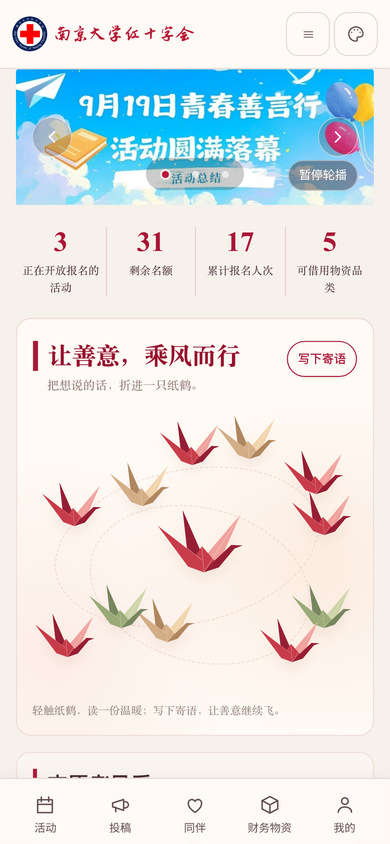 |

### 活动广场

组合类别、地区、校区、状态筛选与关键词搜索，发现活动并完成报名、结果查询与现场签到。

| 桌面 | 手机 |
| --- | --- |
| 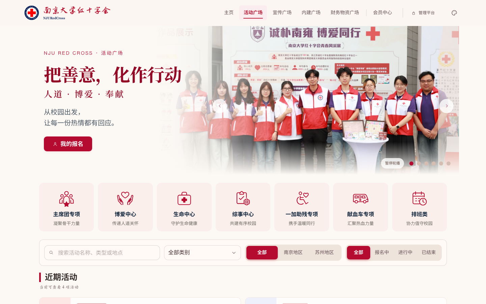 |  |

<details>
<summary><strong>查看献血车日历、其余公众端页面与管理端</strong></summary>

### 献血车报名日历

按周次、服务点位和剩余名额查找班次，支持舒展/紧凑两种视图。

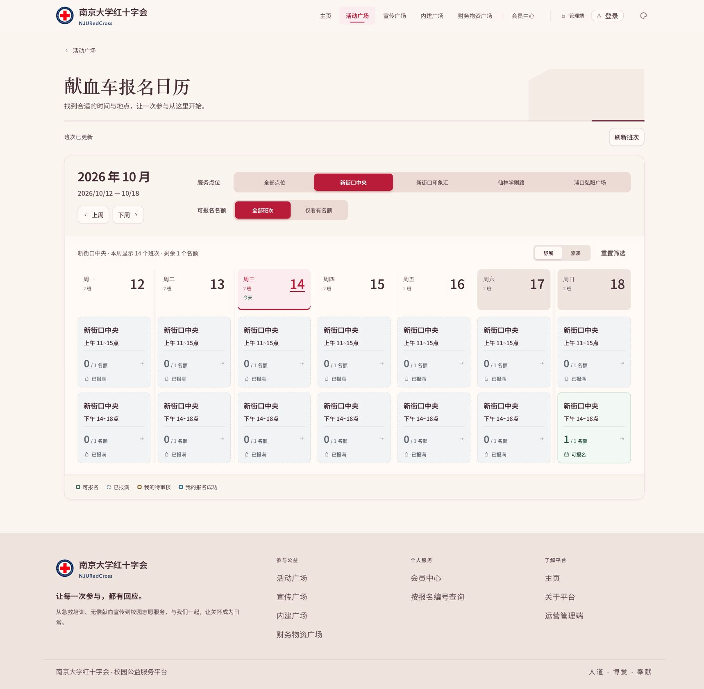

### 宣传广场

投稿专栏、影像作品、任务申领与宣传展示四个独立板块，署名或匿名提交，经人工审核后展示。

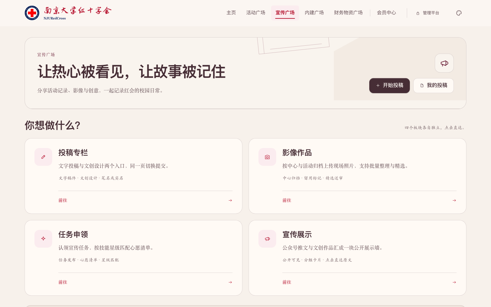

### 内建广场

生日祝福与早安晚安·同行计划：自愿加入、按校区时段与兴趣匹配同伴，内容经审核后转达。

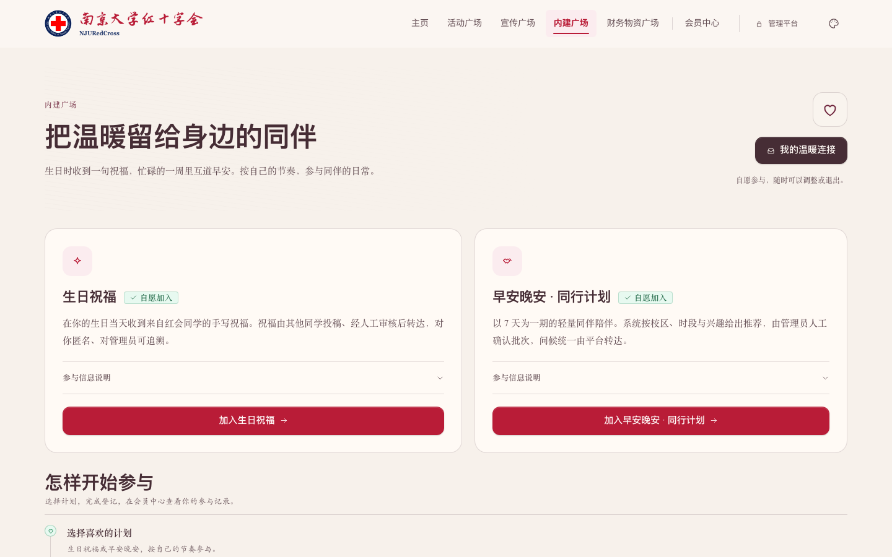

### 财务物资广场

急救箱、血压计、宣传展架等物资面向校内班级、社团和公益活动开放借用：填写申请 → 管理员审批 → 现场领取与归还留档。

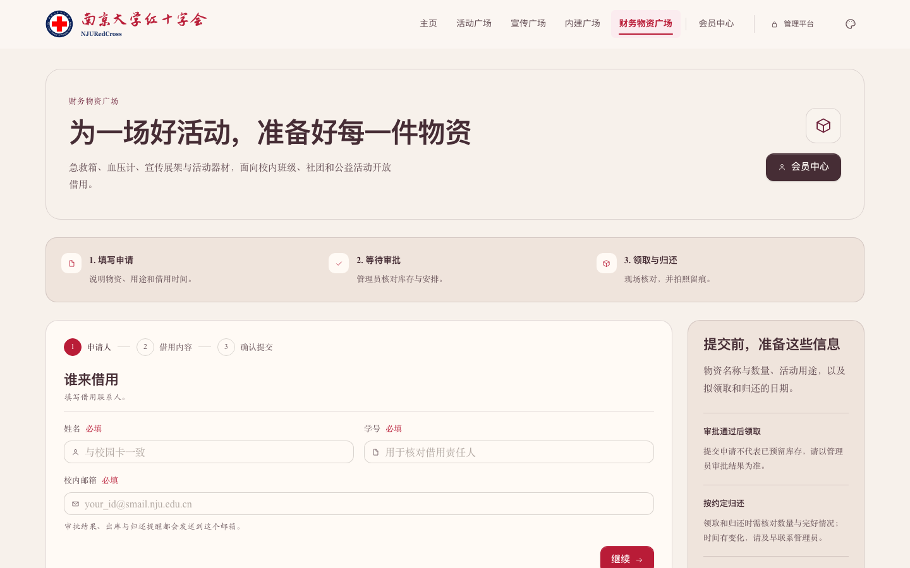

### 会员中心

个人资料、参与记录、志愿时长（服务/培训/交通分列）、我的技能与温暖连接，一处查看全部参与痕迹。

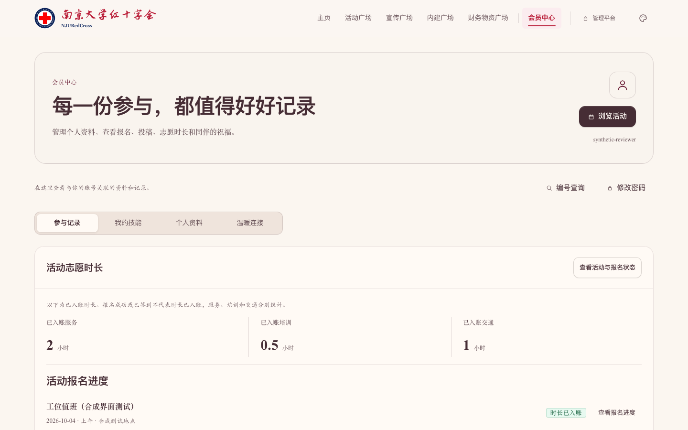

### 管理端 · 运营总览

集中展示待办事项、高优先级、需处理与可稍后四个队列，以及活动运营趋势与待办分布。

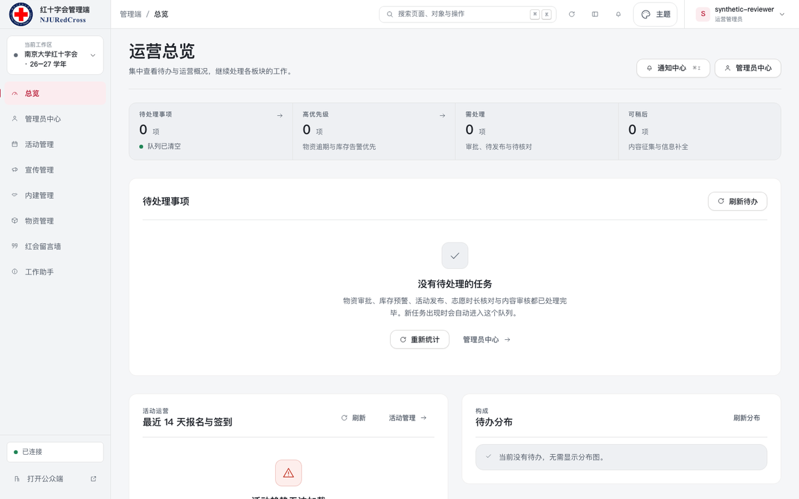

### 管理端 · 活动管理

统一的审批发布、名单确认、签到核验与时长审核工作区，支持批量录取、成功邮件编辑与 Excel 导出。

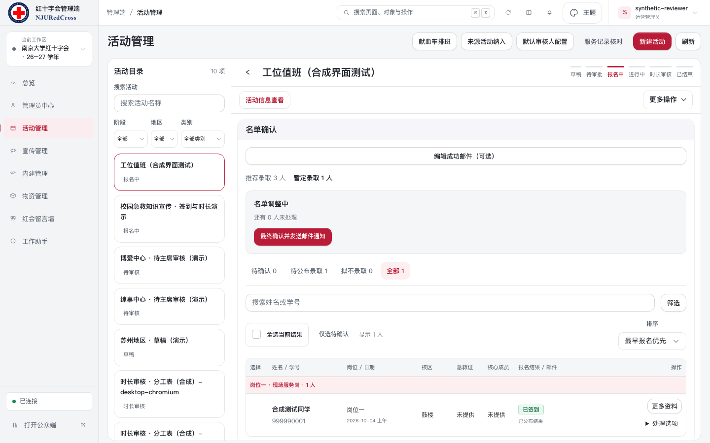

### 管理端 · 物资管理

借用审批、库存台账、出入库流水与低库存预警，配合扫码定位完成现场盘点与归还核验。

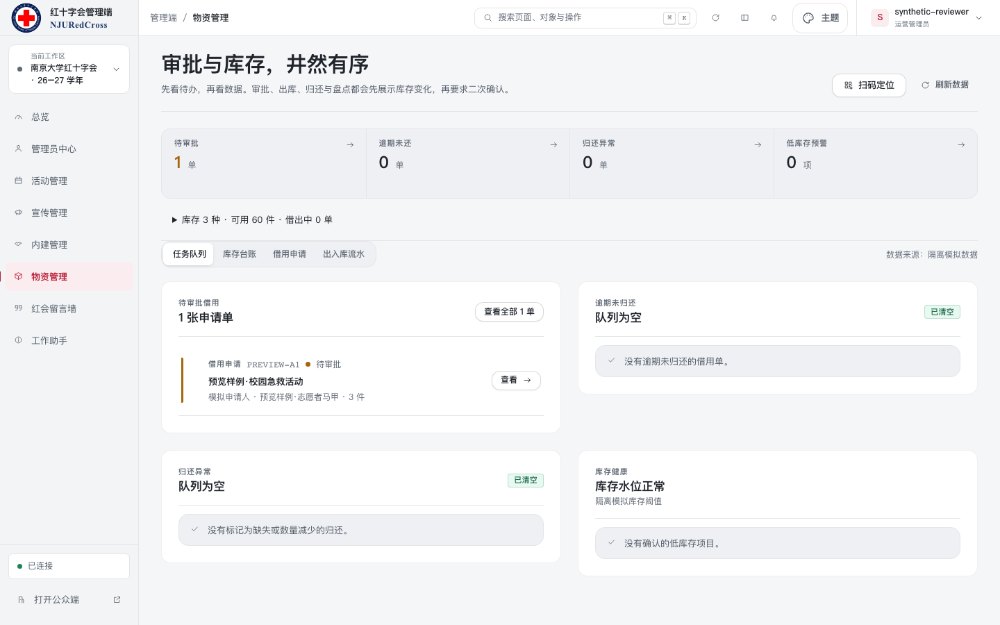

### 管理端 · 内建管理与留言墙

生日祝福、早安晚安的登记审核与举报处理；红会留言墙让每一段寄语有署名、有出处、可下架。

| 内建管理 | 红会留言墙 |
| --- | --- |
| 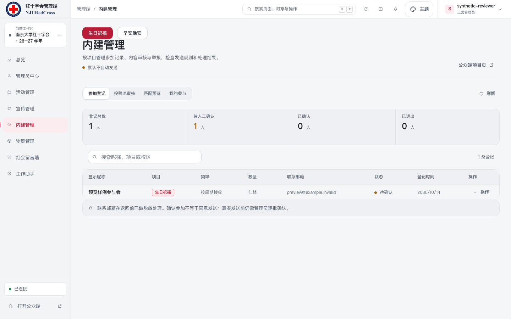 | 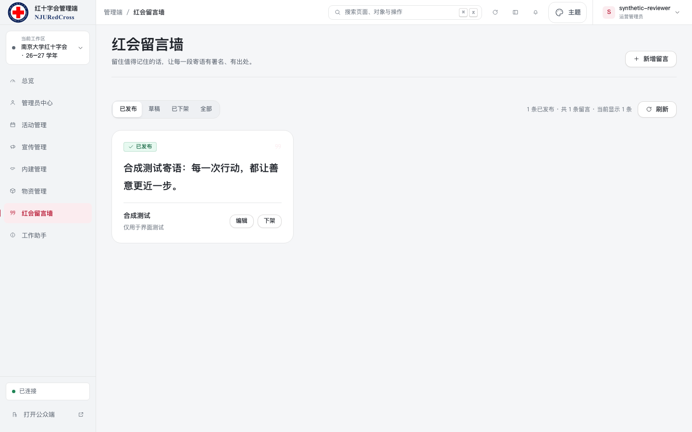 |

### 管理端 · 管理员中心

账号、模块权限、工作区偏好、系统状态与操作记录的集中入口。

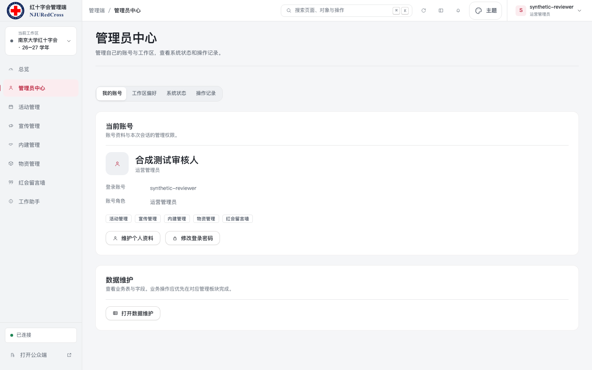

</details>

截图更新于 **2026-10-25**，源码基线与复现方法见 [截图说明](docs/SCREENSHOTS.md)，可用 `npm run screenshots` 一键重新生成。

## 页面导览

公众端以四个广场和会员中心作为主入口，管理端以八个板块组织运营工作。

### 公众端（面向全体同学）

| 页面 | 路径 | 功能说明 |
| --- | --- | --- |
| 官网首页 | `/` | 活动轮播、实时统计（开放活动/名额/报名人次/物资品类）、千纸鹤寄语墙、专题入口 |
| 活动广场 | `/events` | 按类别/地区/校区/状态筛选活动，查看详情并报名，报名后可查询结果与请假 |
| 献血车日历 | `/workflow-events?type=blood` | 按周次与点位浏览献血车班次，显示剩余名额与报名状态 |
| 宣传广场 | `/outreach` | 投稿专栏、影像作品、任务申领、技能认证与宣传展示；支持署名或匿名 |
| 内建广场 | `/community` | 生日祝福、早安晚安·同行计划的加入、审核与匹配说明 |
| 财务物资广场 | `/materials` | 物资清单查看与借用申请；`/reimbursements` 提供报销入口 |
| 会员中心 | `/me` | 个人资料、参与记录、志愿时长、我的技能、温暖连接与账号设置 |
| 参与状态 | `/status` | 凭报名编号查询本人参与与签到记录 |
| 注册 / 登录 | `/register` · `/login` | 校园邮箱验证码注册，支持学号/姓名别名登录 |

### 管理端（面向运营与负责人，`/console`）

| 板块 | 路径 | 功能说明 |
| --- | --- | --- |
| 运营总览 | `/console/overview` | 待办事项队列、活动运营趋势、待办分布 |
| 活动管理 | `/console/events` | 活动创建与审批发布、名单确认与录取通知、签到核验、时长审核与导出 |
| 宣传管理 | `/console/outreach` | 投稿审核、排期发布、影像归档与展示维护 |
| 内建管理 | `/console/community` | 生日祝福与早安晚安的登记审核、举报处理 |
| 物资管理 | `/console/materials` | 借用审批、库存台账、出入库流水、扫码定位与归还核验 |
| 红会留言墙 | `/console/messages` | 留言整理、发布与下架 |
| 工作助手 | `/console/agent` | 活动筹备、推文创作与美编建议的 AI 辅助 |
| 管理员中心 | `/console/admin` | 账号与模块权限、工作区偏好、系统状态、操作记录与数据维护 |

## 平台能力

公众端以四个广场和会员中心作为主入口，管理端以七个板块组织运营工作；桌面与手机共用原生组件和设计系统。

| 场景 | 参与者体验 | 运营与协作 |
| --- | --- | --- |
| 活动与献血车 | 活动目录、周日历、报名、结果查询、请假与签到 | 活动申请与发布、名单确认、签到核验、时长审核与 Excel 导出 |
| 宣传广场 | 投稿专栏、影像作品、任务申领、技能认证与宣传展示 | 多级审核、申领审批、部门/活动附件归位与展示维护 |
| 内建广场 | 生日祝福、早安晚安同行名片、兴趣筛选与留言 | 祝福与名片审核、举报处理和成员管理 |
| 财务物资广场 | 物资查询与借用申请 | 审批、库存、出库、归还与流水 |
| 会员中心 | 个人资料、本人参与记录、任务与账号设置 | 按业务权限读取本人记录 |
| 管理平台 | 管理员中心、运营总览与红会留言墙 | 模块权限、活动/宣传/内建/物资管理、设置与系统状态 |

账号角色为 `member`、`platform_admin`、`super_admin`，管理员可按模块授权。业务审核岗位另由具体流程配置。实现与配置见 [架构](docs/ARCHITECTURE.md)、[正式数据连接](docs/PRODUCTION_DATA.md)、[任务与技能](docs/TASKS_AND_SKILLS.md) 和 [审核工作流](docs/REVIEW_WORKFLOW_MANUAL.md)。财务物资广场当前以物资业务为主，财务报销等扩展按 [路线图](ROADMAP.md) 讨论。

## 快速开始

需要 Git、npm 和 **Node.js 22.13+**，建议使用 `.nvmrc` 指定的 Node.js 24；CI 覆盖 Node.js 22、24、26。

```bash
git clone https://github.com/WANGLEVY9/NJURedCross.git
cd NJURedCross
npm ci --ignore-scripts
npm run preview
```

打开 <http://127.0.0.1:3000>。静态预览无需配置，业务请求显示未配置提示。停止服务使用 Ctrl+C。

体验合成数据下的完整业务与管理流程（含本页截图场景）：

```bash
npm run preview:workflow   # 打开 http://127.0.0.1:3121，自动进入合成管理员会话
npm run screenshots        # 可选：重新生成 docs/assets 下的 README 截图
```

打开 <http://127.0.0.1:3121>。数据保存在内存，重启后恢复演示初始状态；该模式不连接学校数据服务或邮件服务。完整业务联调按 [运行与复现指南](docs/GETTING_STARTED.md) 配置独立测试环境。

检查代码、文档和合成业务回归：

```bash
npm run verify
npm run check:links
```

浏览器回归首次安装 Chromium 后执行：

```bash
npx playwright install chromium
npm run test:browser
```

平台为原生 ES Modules / CSS，前端直接提供静态资源，无需编译。详细环境、端口和故障排查见 [运行指南](docs/GETTING_STARTED.md)。

## 参与共建

| 我想做什么 | 从哪里开始 |
| --- | --- |
| 询问使用方式、交流想法 | [Discussions](https://github.com/WANGLEVY9/NJURedCross/discussions) · [支持指南](SUPPORT.md) |
| 报告可复现问题 | [Bug 报告](https://github.com/WANGLEVY9/NJURedCross/issues/new?template=bug_report.yml) |
| 提出功能方案 | [功能建议](https://github.com/WANGLEVY9/NJURedCross/issues/new?template=feature_request.yml) · [路线图](ROADMAP.md) |
| 改进界面、文档或可访问性 | [体验与文档建议](https://github.com/WANGLEVY9/NJURedCross/issues/new?template=design_documentation.yml) |
| 提交代码或文档 | [贡献指南](CONTRIBUTING.md) · [开发约定](docs/DEVELOPMENT.md) |
| 私下报告安全问题 | [安全政策](SECURITY.md) |
| 了解维护与决策方式 | [项目治理](GOVERNANCE.md) · [行为准则](CODE_OF_CONDUCT.md) |

第一次贡献可以从文字修正、预览环境复现、键盘/手机布局检查或小范围回归开始。先检索现有 Issue 和 PR，再说明目标与验收条件；无需生产数据权限。维护者通过审核、反馈和合并帮助贡献落地，参与和署名方式见 [CONTRIBUTORS](CONTRIBUTORS.md)。

## 技术与架构

**前端**：原生 JavaScript ES Modules、CSS、共享组件、主题与动效。

**后端**：Node.js 原生 HTTP、SeaTable SDK、Nodemailer、ExcelJS 与附件适配。

**验证**：Node 原生测试、Playwright 桌面/手机及跨浏览器回归、Python 发布安全检查。

```text
server.js       服务组装、会话、权限与业务路由
lib/            身份、活动、宣传任务、附件、内建、邮件与 HTTP
public/         官网、会员与管理端、共享组件、样式与静态资源
scripts/        检查、预览、截图、迁移、诊断与发布工具
tests/          合成业务、浏览器、时区与发布安全回归
ops/            部署相关配置示例
docs/           架构、设计、运行与运营指南
reports/        按日期保存的核验摘要与历史记录
.github/        CI/CD、协作表单与 PR 模板
```

模块入口见 [后端](lib/README.md)、[前端](public/README.md)、[脚本](scripts/README.md) 和 [测试](tests/README.md)。

## 质量与发布

[GitHub Actions](https://github.com/WANGLEVY9/NJURedCross/actions/workflows/ci.yml) 提供六类质量检查：Node.js 22/24/26 × Linux/Windows 验证、发布安全、桌面/手机 Chromium、Firefox/WebKit 关键流程、三个业务时区及 HTTP 覆盖率。完整配置以 [CI 工作流](.github/workflows/ci.yml) 为准。

贡献者使用分支与 PR；Owner 已授权的维护可按仓库约定验证后直接推送 main。`Quality gate` 通过后，main 自动部署，服务器发布清单记录提交与运行文件哈希。发布、配置及数据迁移分别管理，操作流程见 [部署与回滚](docs/OPERATIONS.md)。

当前以单实例运行；跨表写入、跨实例协调和历史时长对账的约定集中在 [架构](docs/ARCHITECTURE.md) 与 [正式数据连接](docs/PRODUCTION_DATA.md)。

## 共建者与协作者

感谢每一位为 NJURedCross 付出时间与热心的开源伙伴。无论是代码、设计、测试、文档，还是一次建议与反馈，你的贡献都让这个项目变得更好。很高兴与你们一起，把校园公益做好。

<table>
<tr>
<td align="center"><a href="https://github.com/Anntharv"><br /><sub><b>Anntharv</b></sub></a></td>
<td align="center"><a href="https://github.com/centriole0413"><br /><sub><b>centriole0413</b></sub></a></td>
<td align="center"><a href="https://github.com/Daily-6"><br /><sub><b>Daily-6</b></sub></a></td>
<td align="center"><a href="https://github.com/Klein-Morett"><br /><sub><b>Klein-Morett</b></sub></a></td>
<td align="center"><a href="https://github.com/Nport-hut"><br /><sub><b>Nport-hut</b></sub></a></td>
</tr>
<tr>
<td align="center"><a href="https://github.com/pace-ys-xv"><br /><sub><b>pace-ys-xv</b></sub></a></td>
<td align="center"><a href="https://github.com/Rouin101"><br /><sub><b>Rouin101</b></sub></a></td>
<td align="center"><a href="https://github.com/WANGLEVY9"><br /><sub><b>WANGLEVY9</b></sub></a></td>
<td align="center"><a href="https://github.com/xinyue-L01"><br /><sub><b>xinyue-L01</b></sub></a></td>
<td align="center"><a href="https://github.com/zhoumiaoooooo"><br /><sub><b>zhoumiaoooooo</b></sub></a></td>
</tr>
</table>

完整名单、署名方式与更新说明见 [CONTRIBUTORS](CONTRIBUTORS.md)。代码贡献记录见 [GitHub Contributors](https://github.com/WANGLEVY9/NJURedCross/graphs/contributors)。设计、测试、文档和讨论同样是项目建设的一部分。


## 文档与许可

[文档导航](docs/README.md) · [设计系统](DESIGN.md) · [测试](docs/TESTING.md) · [更新记录](CHANGELOG.md) · [项目治理](GOVERNANCE.md) · [可访问性](ACCESSIBILITY.md) · [支持](SUPPORT.md)

源码采用 [Mozilla Public License 2.0](LICENSE)。复用、贡献、第三方资源和品牌标识的说明集中在 [许可与资源](docs/LICENSING.md)；请保留正式许可与原作者通知。学校品牌、个人资料和运营服务按各自授权管理。
