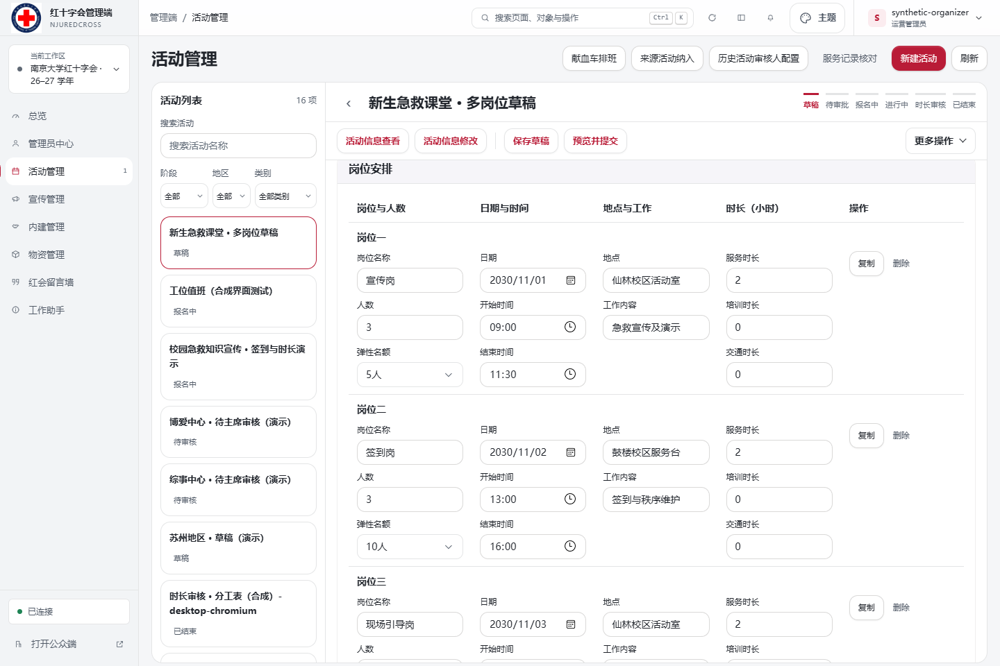
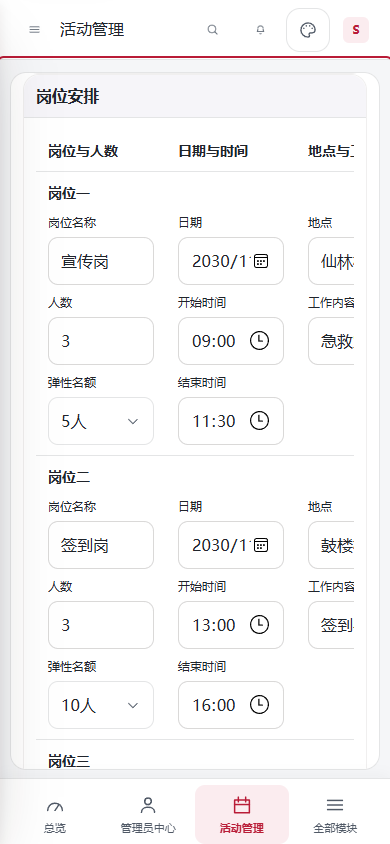

# 草稿岗位的弹性名额

## 使用规则

单岗位活动和多岗位活动的每个岗位均可在草稿中配置“弹性名额”。默认关闭（0人），开启时可选5至10人的整数。例如需求20人、弹性5人，用户端继续显示需求20人，实际最多允许25人报名。达到需求人数后仍可报名，达到实际上限后才显示报满。

沿用既有“推荐录取名额／报名上限”机制：管理员可以在实际上限内录取，超过需求人数时继续使用现有弹性录取确认。此配置不会自动录取。手动截止、报名期限、时间冲突、同人重复报名及当前权限检查继续生效。

管理员保存内容和提交预览可查看需求人数、弹性名额与报名上限；公开活动卡片、岗位卡片和通知正文只展示需求人数，不把实际报名上限作为需求展示。复制岗位、复制活动、退回重提及发布后允许的信息编辑保留对应设置；缩减上限不能少于已有占用报名。

## 实现与数据边界

- 草稿与岗位的可选字段为 `flexibleCapacity`；缺失或空值按关闭处理，不给旧草稿自动追加字段，也不批量改写既有活动。
- 正式单岗位配置保留 `flexibleCapacity`，复用 `registrationLimit = 容量 + flexibleCapacity`。多岗位分别生成对应上限，项目需求总人数不加弹性人数。
- 范围在保存、工作流转换和岗位生成处重新校验。提交后的名额配置包含在审批摘要中，篡改后不能沿用原批准摘要。
- 普通活动名额底表按实际报名上限协调，仅创建名额投影，不制造报名记录。报名写入继续在既有队列内重读占用数并校验上限。
- 用户端和管理端报满状态使用实际上限，需求剩余数最低为0；不会出现负数或“需求已报满却错误禁用报名”的情况。
- 本次没有新增依赖、业务表、数据库迁移或远程数据读取。计算复用已读取的活动配置与报名记录。

## 验证记录（2026-10-24）

- `npm run check`、`npm run lint`、`npm run check:links` 通过。
- `npm run verify` 的权限、身份、档案及相关业务回归通过；全量 Node 测试2435通过、1失败。唯一失败为既有 `tests/web-assets.test.mjs:194` 在当前 Windows 环境创建符号链接的 `EPERM`，未绕过该测试或调整系统权限。
- Edge 桌面和手机回归运行 `activity-flexible-capacity.spec.mjs`、`activity-draft-workspace-v2.spec.mjs`、`ordinary-groups.spec.mjs`、`booking-presentation.spec.mjs`：100通过、2按设计跳过。
- 并发验证：需求3人、弹性5人，同时提交9个不同账号的报名，仅8个成功；可以沿用既有录取流程确认这8人。名额投影保留8个席位，需求仍为3。
- 覆盖两个岗位独立配置、保存重开、复制岗位、审批发布、保留编辑、缩减保护，以及需求20人已报20人时仍可提交、达到25人后停止报名。旧的关闭报名、报满提醒和报名交互回归通过。
- 实际本地多岗位预览在390px手机尺寸无页面横向溢出，岗位表保持既有局部横向滚动。

## 本地查看

PowerShell 设置 `$env:PREVIEW_FLEXIBLE_CAPACITY='1'` 后执行 `npm run preview:admin`。打开启动输出中的多岗位草稿或“报名中”样例，即可分别检查管理员配置和用户端需求人数。此模式仅使用内存合成数据，不读取 `.env`，不连接生产数据库，不发送真实邮件；重启清空样例。

## 合并与恢复

功能在独立分支开发。与人员配置 PR #30 同时修改草稿契约、表单与工作流转换，合并时须同时保留人员字段及本字段。

恢复时保留已保存的弹性配置和报名记录。若已有超过需求人数的报名，不应直接回到只支持需求人数的校验版本；须先核对活动上限、占用和名额投影，防止既有报名被判为不一致。发布仍按运维流程执行，本地验证不表示已合并或部署。
