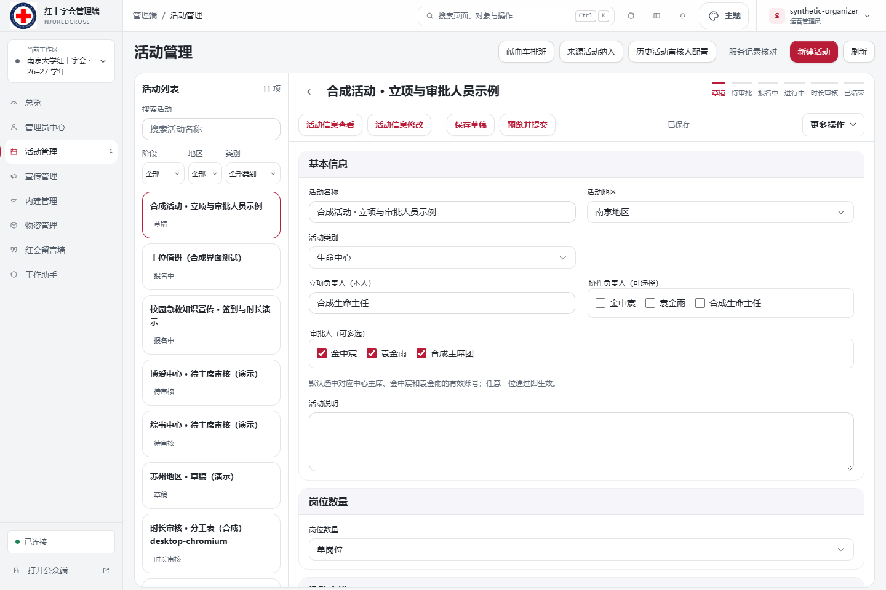
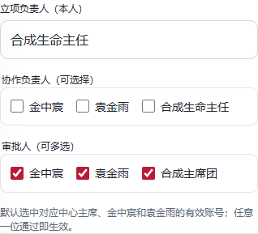

# 活动立项与审批人员验证（2026-10-23）

验证对象：活动基本信息中的立项负责人、协作负责人和审批人。样例账号、活动及角色全部在本地内存中构造；两个具名审批人使用 `synthetic-default-*` 账号，不表示生产账号配置已核验。

## 行为与数据边界

- 立项负责人固定为创建账号，协作负责人可选择并在正式活动中保留管理权限。
- 审批默认匹配对应地区、中心的有效主席与两个具名有效终审账号；按稳定 ID 保存，任意一位通过即可生效。
- 手动取消的审批人不会在重新打开时自动勾回；地区或类别变化后重新配置，过期响应不能覆盖新范围。
- 未选择的总权限账号不能审核这次申请；提交及编辑重新核验角色，拒绝改写或移除立项负责人。
- 复制时重新绑定创建者；草稿详情、保存、预览、复制、提交及响应丢失后的核对使用定向读取。回归中禁止草稿全表读取，完整提交及重试仍成功。
- 自动默认值不触发离开确认；手动修改仍受保护，提交前须保存并预览最新内容。

## 执行结果

- `npm run check`、`npm run lint`、`npm run check:links` 通过。
- `npm run verify` 的权限、身份和档案检查通过；全量 Node 用例在本机遇到既有 Windows 符号链接权限限制。以 `node --test --test-concurrency=4 tests/*.test.mjs` 复核，同样只剩 `tests/web-assets.test.mjs:194` 的 `symlink EPERM`；未修改该测试或系统权限。
- Edge 执行 `activity-draft-workspace-v2.spec.mjs`、`activity-role-settings.spec.mjs`、`activity-project-people.spec.mjs`：92 通过、2 按设计跳过。覆盖桌面和手机尺寸、保存、预览、提交、审批、发布、退回重提、复制、手选保留与切换范围的异步竞态。
- 独立人员示例预览核对默认选中 3 人、立项人只读、手机页面无横向溢出。

## 合成预览截图

桌面完整工作区：

手机人员字段：

启动方式与权限配置规则见 [工作区说明](ACTIVITY_WORKSPACE_V2.md#本地管理端预览) 和 [权限规则](ACTIVITY_PERMISSION_POLICY.md#立项协作与审批人员2026-10-23)。此记录不表示已经提交 PR、合并或部署。
