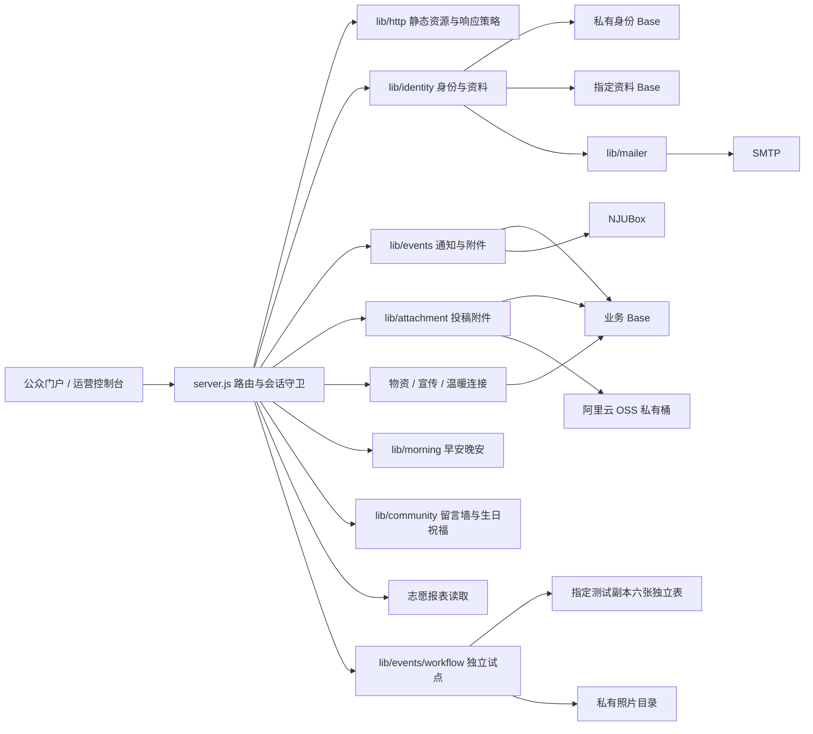

# 代码架构与数据边界

按业务域划分模块的单体 Node.js 应用。两个浏览器界面共用同一套 HTTP API，部署为单实例。前端无构建过程，后端使用 ES Modules 和顶层 await 装载账号。



## 模块职责

| 路径 | 职责 | 约束 |
| --- | --- | --- |
| `server.js` | 配置、连接组装、会话/CSRF、权限与业务路由 | 应用入口，导入即启动服务；前端与离线测试都不引用它 |
| `lib/http/` | CSP 与安全响应头、静态文件、分页读取、展示读缓存、请求预算 | 不依赖业务数据 |
| `lib/cache/` | 带标签的读缓存引擎与写表记账 | 只保存展示投影，不介入鉴权与写入 |
| `lib/queue/` | 持久化任务队列（SQLite）与后台 worker | 只承载副作用，去重、重试、崩溃恢复 |
| `lib/seatable-auth.js` | 合并并发认证、到期前刷新、失败后重试 | 主业务、志愿、身份和资料连接统一使用 |
| `lib/permissions.js` | 控制台权限范围与路径映射 | 权限由服务端裁决，前端只做界面分流 |
| `lib/identity/` | 口令哈希、邮箱验证、账号、身份绑定与资料同步 | 私有 Base 不通过通用行/元数据接口暴露 |
| `lib/events/` | 通知、附件、原表核对、献血车、志愿试点与时长导出 | 通过显式上下文调用会话与数据访问能力 |
| `lib/attachment/` | 内容投稿与影像：表契约、多级审核、门户/审核 HTTP 域路由、OSS V4 签名适配 | 浏览器只与本站通信（服务端中转）；OSS 未配置时上传端点 503 降级，不落半条记录 |
| `lib/morning/` | 早安晚安同行名片、标签、好友邀约、反馈、资料修订与留言历史 | 走同一套门户/控制台会话守卫 |
| `lib/community/` | 留言墙与温暖祝福的审核、入库、投递与举报 | 投递开关由环境配置控制 |
| `lib/mailer.js` | 邮件传输、幂等检查与发送记录 | 生产走 SMTP；日志通道仅限开发 |
| `lib/materials/` | 库存、单资产借还、资料维护和流水恢复；隔离本地预览 | 由入口注入数据客户端、操作人、时钟与写队列 |
| `public/app/core/` | API、路由、状态、DOM、格式与动效 | 不引入任何服务端模块或 Token |
| `public/app/ui/` | 跨界面的组件与交互 | 对业务数据源无直接依赖 |
| `public/app/portal/` / `console/` | 双界面外壳与页面编排 | 都通过 `core/api.js` 访问同源服务 |

## 请求与身份

页面由 `public/index.html` 加载 `public/app/main.js`。客户端先读取 `/api/auth/session` 再执行路由与界面守卫；服务端对每个受保护 API 独立校验会话、角色、权限与写请求的 CSRF。账号角色与托管字段只从身份 Base 取得，不从个人资料源推导。

业务数据、账号凭据、志愿报表读取、受测试 UUID 门禁保护的试点写入与资料写连接按用途隔离。账户的 `scrypt` 哈希、邮箱验证与业务关联记录保存在私有身份 Base。资料映射要求已验证邮箱、学号/姓名一致以及稳定的账号绑定；冲突时关闭自动同步并转为人工核验。资料写入先保存私有值，再按白名单同步源表，失败保留待同步状态。

## 依赖方向和扩展规则

前端：`main → shell/page → core/ui`。后端：`server → domain/http`；业务域可以依赖独立工具和显式上下文，不反向导入 `server.js`。脚本与测试调用领域函数，独立管理输入。

新的业务域沿用 `lib/<domain>/api.js` 路由接口，以显式 `ctx` 注入会话、数据源、审计和响应能力。边界检查先于数据写入；不接受调用方传入的任意 Base、任意表名或账号标识来替换会话身份。

## 拆分进度

HTTP 层已抽出为无业务依赖的模块，长运行连接的认证入口已统一。物资、宣传与温暖连接的路由仍在 `server.js`，按以下顺序继续拆分：

```text
物资 → 宣传 → 温暖连接
```

每一步保持 API、表结构与异常语义，补故障与权限回归后再发布。多实例部署之前需先解决进程内锁、限流、会话撤销与跨表一致性。

## 领域模块

**志愿流程试点**（`lib/events/`）—— `workflow.js` 是六张独立表上的活动生命周期状态机，管理申请版本、名单、签到与明细恢复；`workflow-api.js` 校验 HTTP 会话、权限、CSRF 与本人归属；`blood-source.js` / `blood-roster.js` / `blood-booking.js` 从市血液中心排班底表生成献血车岗位并处理名额占用；`attendance-photo.js` 私有保存并受控读取签到照片；`hours-export.js` 产出十列 Excel 草稿；`volunteer-workflow.js` 读取旧表关联并派生核验状态；`safety.js` 提供单实例串行队列与完整读取门禁。

**身份**（`lib/identity/`）—— `challenges.js` 处理验证码创建时间相同的排序歧义，存在多个最新待使用码时拒绝猜测。

**HTTP**（`lib/http/`）—— `errors.js` 把上游 SeaTable 认证失败映射为数据服务不可用，与普通鉴权错误区分开，避免上游故障被当作用户会话失效；`display-reads.js` 让展示读共享一次查询，鉴权与写入始终直连权威源。前端 `core/api.js` 配合处理上游错误与 CSRF 重试。

**缓存与队列**（`lib/cache/`、`lib/queue/`）—— 展示投影按表打标签，写请求结束后只失效依赖被写表的部分，公共快照按依赖表级联丢弃；后台副作用进入 `jobs.sqlite`，由单进程 worker 按租约执行、退避重试，重启后继续。边界与理由见 [读缓存与后台队列](CACHE_AND_QUEUE.md)。

**内容投稿附件**（`lib/attachment/`）—— `api.js` 是域路由的现役范例：`attachmentRoutes(req, res, url, ctx)` 在 `/api/public/` 兜底之前拦截，`ctx` 注入 json/行存储/会话守卫/审计/限流/归属校验；投稿绑定时序为「先投稿行、后回填附件」，不引入事务假设。表契约与状态机见 [投稿附件专项](SUBMISSION_ATTACHMENTS.md)。

真实流程边界见 [试点指南](WORKFLOW.md)。
