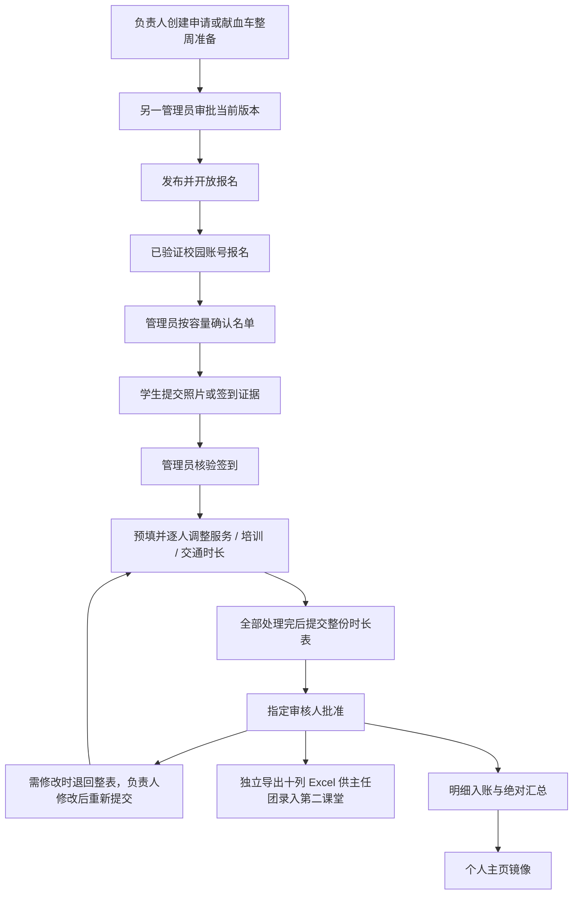

# 志愿活动与献血车试点

## 范围与开关

学生入口 `/workflow-events`，管理入口 `/console/workflow`，个人中心独立显示试点时长。必须配置 `PLATFORM_TEST_WORKFLOW=true` 且志愿 Base UUID 与代码中的指定测试副本一致；真实认证返回的 UUID 也需一致。默认关闭。当前版本不能任意切换到正式库。

这是独立流程，不是旧活动总表/累计时长系统的自动迁移。旧历史、资料同步和试点汇总不得相加后冒充正式年度时长。

## 生命周期



申请批准前不能发布；负责人不能批准自己的申请或核对后的时长。批准绑定版本与摘要，来源或证据改变时停止入账。容量确认和事件写入在单实例队列内执行。

### 六环节状态与操作人

持久化状态仍是 `草稿 / 待审核 / 可发布 / 报名中 / 进行中 / 停点 / 已结束 / 已归档`，
控制台按负责人视角呈现六个环节（判定集中在 `public/app/shared/activity-stage.js`）：

| 环节 | 持久化状态 | 可见/可操作 | 更多操作内的阶段任务 |
| --- | --- | --- | --- |
| 待审核 | `待审核` | 分管主席可审批，负责人只读 | 审批通过 / 审批不通过 |
| 待发布 | `可发布` | 负责人 + 分管主席 | 立即发布 / 定时发布 / 复制报名通知 |
| 报名中 | `报名中` | 负责人 + 分管主席 | 报名截止 |
| 进行中 | `进行中`、`停点` | 负责人 + 分管主席 | 提交时长表 |
| 时长审核 | 进行中且整表提交记录为 submitted | 指定审核人可批准、退回和导出；负责人只读预览 | 在线预览 / 导出 Excel / 结束活动 |
| 已结束 | `已结束` | 负责人 + 分管主席 | 查看时长表 |

- **报名截止与结束活动分开**：`POST /events/{id}/close` 只关闭新报名并把状态改为 `进行中`，
  现场签到、时长录入与导出继续可用；`POST /events/{id}/finish` 才写入 `已结束`。
  献血车班次仍由 NJUTable 排班表按时间归入 `已结束`。
- **整表提交不改写批准配置**：网页创建活动的提交、退回、缺席说明和版本存入服务器私有状态目录的
  `activity-hours-review.json`，不新增 NJUTable 列，不因签到录入第一条时长就进入审核。
  所有应参加者必须录入完整签到及时长，或注明缺席；已批准请假者不计待处理。
  全员请假或无人参加时允许提交空表收尾，下载仍不生成空的时长 Excel。
  提交后负责人只读，指定审核人退回整表后方可继续修改未通过的明细，已通过明细保持不可改。
  全部明细审核完成后，由指定审核人单独结束活动；下载不会自动结束。
- **审核权限**：网页创建活动只允许审批快照中指定的审核人及现有超级管理员审批和复核；
  主席团/指导组的全局管理身份本身不再代表可以审核所有活动。指定多人时任意一人可处理。
  负责人保留只读预览，原有独立复核和本人时长回避规则保留。
- **自动献血车兼容例外**：NJUTable 自动生成班次没有创建审批快照，本轮按用户确认保留原签到、
  时长审核、按时间结束和按月汇总流程，不套用新的整表提交/退回/手动结束门禁。
- **通知暂缓**：Excel 下载链接的站内通知和新增流程待办均未实现；当前按钮仅下载，不声称已发送。
- **岗位编号**由 `public/app/shared/position-labels.js` 按岗位配置顺序生成（岗位一、岗位二……），
  名单表与签到表共用同一编号；签到表不再占列展示院系与红会身份，收进「签到详情」抽屉。

## 创建、草稿与重新审批

新建/复制活动采用三步：活动信息 → 岗位安排 → 通知与审批。每步先保存草稿，返回上一步复用原活动 ID，不重复创建。整体统一报名无需额外配置，使用默认服务岗并继承活动时间、地点和名额；按岗位报名需要配置有效岗位及截止时间。第三步可编辑通知、选填计划开放时间，再主动提交一次审批。计划时间本身不会自动批准或发布活动。

编辑已审批但未发布的活动或通知，实际修改保存后清空旧批准并回到草稿，由负责人主动提交。尚未修改的已保存草稿不需要重复写入。已发布活动、岗位生成行及已有参与记录的保护规则保留。

## 私有整表状态的备份与恢复

生产必须配置 `PLATFORM_WRITE_STATE_DIR` 私有持久化目录，整表状态保存在其中的 `activity-hours-review.json`；本地开发未配置目录时默认使用 `.write-state`。该文件包含缺席说明、处理账号及整表版本，属于私有业务运行状态，必须纳入原私有目录备份，不得提交 Git 或放入静态目录。单实例串行写入，临时文件原子替换；旧页面版本冲突返回 409，损坏或运行中遗失文件时停止操作并返回 503。无路径的单元测试和预览使用内存状态。

首次升级时，原有网页活动没有整表记录，视为尚未提交；已批准时长保留，不自动重审或改写。负责人补齐其余人员并提交后继续收尾。自动生成献血车沿用原流程。没有执行生产迁移、生产目录写入或真实表修改。

回滚前停写并同时备份私有状态与业务时长记录；不要通过删除 JSON 来“解锁”。恢复应使用对应时间点的文件，并核对其后是否发生签到、时长批准或结束操作；恢复过旧文件会丢失新提交和缺席状态。回滚到旧代码会失去整表锁定门禁，应暂停时长写操作直至恢复新版或由维护者核对，不把代码回滚等同于业务数据回滚。

## 献血车与请假

整周排班读取既有星期/点位/班次模板组合，不扩展为全点位笛卡尔积。负责人明确输入日期、业务周次、容量和三类时长；不把班次长度直接当作志愿服务时长。同班次重复准备复用记录，规则变化需明确处理。

报名防班次重叠；请假需审批，审批前占用名额且禁止签到，批准后释放名额。替补限两周内的开放且有名额班次，仍经负责人确认。停点关闭新报名和照片签到，展示原因。

普通活动签到窗口为活动当天；献血车为对应班次起止时刻，使用北京时间。当前没有自动宽限。照片内容的日期/真实性由管理员判断。

## 数据、文件和恢复

管理端以项目为入口：普通多班次活动按 `报名页配置.ordinary.groupId` 关联「网站普通活动项目表」，献血车按自然月归集。项目内展示日期、地点、时段和岗位；没有显式关联的同名活动不合并。班次仍保留原 `_id`、活动ID，报名、签到与时长仍写回原行，不预占或合并真实报名记录。

项目报名、成员资料、签到录入和时长审核使用同一班次范围。批量确认及独立签到每次最多100条，跨项目记录在写入前拒绝；每条仍执行原有资格、时间与证据校验并返回独立结果。时长录入采用各班次自己的默认配置，不套用项目首班；时长待定的项目只支持独立签到核验。统一报名截止和开关仍写入项目父表，单班次配置操作必须进入班次详情。

| 独立表 | 用途 |
| --- | --- |
| 网站活动流程表 | 申请、准备、批准版本、发布与停点 |
| 网站活动报名总表 | 稳定账号归属、名单、请假与签到照片引用 |
| 网站活动签到表 | 报名关联与核验记录 |
| 网站服务时长明细表 | 幂等键、来源摘要、三类时长与批准/入账状态 |
| 网站志愿时长汇总表 | 从明细重建的绝对汇总 |
| 网站个人主页表 | 试点时长镜像 |

照片支持 JPEG/PNG/WebP，最多 4MB；默认生产目录 `/var/lib/njuredcross-evidence`，目录 700、文件 600，访问限本人/活动管理员并禁缓存。该目录单独备份；代码回滚不能恢复丢失照片。

入账从持久化明细重建绝对总量，合成回归覆盖重复调用与跨表半成功后的恢复。跨入口写入没有事务锁：检测到冲突时停止自动操作，转为人工核对。

管理端「签到核验」提供搜索、状态筛选、升降序排序、逐人编辑、按勾选字段批量修改和批量确认。姓名、学号、院系独立成列；表格多行居中展示，服务编辑在最右侧。签到依据显示实际照片、旧表文字或管理员核验说明，照片可打开查看；按可见记录读取文字依据，每页同时最多两个读取请求。三类时长及工作内容按活动配置预填；普通活动支持管理员人工核验，签到说明不要求逐人填写。献血车仍要求照片证据，请假待审批的参与者不能签到。网页创建活动结束后只读；NJUTable 自动生成献血车保留原有结束后补核验能力。

「时长审核与导出」将参与者信息、三类时长、工作内容、备注、状态和操作分列展示，支持直接编辑待审核明细、按勾选字段批量修改、批量审核与独立导出。正式工作日期每行一个日期及可选时段，支持添加日期；批量日期列表应用到所选的每条待审核明细，其他未勾选字段保留原值。历史已退回记录在④显示「待录入」，在⑤全部名单显示「待重新录入」，沿用原有重新录入限制。核对人或参与者不能批准自己的记录，沿用现有 `super_admin` 例外；接口从会话获取身份及角色，不接受客户端覆盖。审核与修改绑定核对摘要，防止审核过时的数据。批次最多 200 条服务记录，每条独立返回结果；批量编辑部分失败时再次保存只重试未成功记录。

审核与导出是独立操作：审核成功后不自动下载，点击「导出 Excel」下载真实 `.xlsx`，下载失败可再次点击重试。文件只包含已批准/已入账记录，保持姓名、院系、学号、具体工作地点、正式工作日期、培训时长、交通时长、服务时长、志愿者具体工作内容、备注这十列。下载不会向第二课堂提交数据；由主任团按原流程录入。同步个人记录仍为独立操作。

手机宽度（800px 及以下）的签到核验、时长审核和在线预览复用后台通用 `recordTable`，搜索复用带图标的 `searchField`。列表用只读摘要展示姓名、学号、状态和三项时长，每页 25 人；选择与逐人操作沿用共享复选框和按钮。点击记录或操作进入核验 / 明细面板编辑，详情表单单列排列。在线导出预览使用同一列表组件展示完整字段。桌面保留可编辑表格，Excel 下载列与审核规则沿用原流程。

④录入与⑤待审核明细均可编辑七项服务信息：具体工作地点、正式工作日期、培训/交通/服务时长、工作内容和备注；姓名、院系、学号只读。⑤通过“编辑明细”修改每次服务，保存后重新汇总，不自动批准，也不把合计重复写入每条明细。保留原核对人，另记修订人/时间；已通过的记录不开放直接修改。

献血车⑤默认按活动所属自然月汇总；网页手动创建的献血车需切换到目标月份的活动后操作，自动生成班次保留原有月份切换，范围为该月所有献血车场次中已在网站核验录入的记录。以姓名＋学号合并，每人一行，三种时长分别累计，地点及日期去重换行。其他活动保留原有按活动规则。服务时长为0的明细可在复核中查看和修改，但不贡献汇总时长、地点、日期，也不进入实际导出。实际导出只包含已通过记录；预览可以选择当前筛选名单或实际导出内容。参考脚本未执行，旧 NJUTable 签到表没有因此自动迁移到网站时长台账。

新版明细使用 `v3:` 来源摘要及核对摘要，覆盖七项服务信息及修订记录，兼容读取原有 `v2:` 和旧摘要；编辑时升级。部署前，`网站服务时长明细表` 需具备八个 text 列：原版本的 `工作内容`、`核对摘要`、`退回原因`，以及本轮新增的 `具体工作地点`、`正式工作日期`、`备注`、`修订人`、`修订时间`。Schema 脚本先只读预览，明确授权后再增列，不删除旧列或重写历史明细。缺列时写入门禁会拒绝业务写入，须在启用新版前完成迁移。回滚前先备份；已有 v3 明细时不可直接退回只支持 v2 的代码，应保留新版摘要读取能力。

## 开发与运维

```bash
npm run preview:workflow
npm run test:node
npm run workflow:schema:preview
```

前两项使用合成环境；第三项需要 `.env` 和指定测试副本，只读预览。`apply-workflow-schema.mjs --apply` 会真实建表/加列；`smoke-workflow-test-base.mjs` 一启动便向六张表追加合成记录，不默认清理。它们不进入普通 verify，不在生产随意执行。

在 PowerShell 用 `$env:PREVIEW_SUPER_ADMIN='1'; npm run preview:workflow` 可体验合成签到、退回、审核及 Excel 下载；预览服务仅监听本机，重启重置记录，不连接真实 Base。

正式迁移前确定唯一写入者，处理旧周期脚本消费范围、历史半成功和调整凭证，再做完整学生端与管理员端验收。历史专项记录见 [流程实施记录](../reports/WORKFLOW_IMPLEMENTATION_2026-10-04.md)。

## NJUTable 自动生成的献血车班次

献血车遵循 `市血液献血车排班表（模板表）` → NJUTable 每周备份更新自动化 → `市血液献血车排班表（汇总底表）`。模板表提供星期、点位和时段范式；网页不复制模板日期，也不自行推进周次。汇总底表作为已生成岗位的实际来源，允许表内临时增加的班次，不按模板删掉例外岗位。现网接入读取 `市血液献血车排班表（汇总底表）`（可由 `SEATABLE_BLOOD_SOURCE_TABLE` 明确指定）。按实际日期、点位、时段分组，每行岗位占一个名额。新周次自动进入公众日历，不写回源表、不新增网站活动申请、不要求重复审批发布。旧手动班次相同业务键从主目录隐藏，已有报名仍保留，并计入同班次占用。源表成功或待确认记录及网站有效报名共同计入名额。网站请求串行检查并写入；若 NJUTable 仍允许另一入口同时报名，跨入口无法提供事务锁，正式迁移需统一报名写入口。

新模板培训、交通默认各 1 小时；服务时长预设可调整。献血车初始服务时长由班次长度给出建议，管理员核验时确认实际数值，历史时长不改写。管理员可批量确认名单、合并核验签到和生成时长草稿。批准前不入账，批准后导出十列 XLSX；调整后的三类时长与来源摘要一起验证，篡改或重复请求不会改变已入账总数。导出文件由负责人在第二课堂系统完成录入。


## 报名中活动的变更申请

独立的报名中活动支持预览差异、提交变更并重新审核。原活动在通过前保持不变；已有签到或时长记录时禁止改写批准版本。适用范围、私有存储与结果核对见 [报名中活动变更审核](ACTIVITY_CHANGE_REVIEW.md)。
