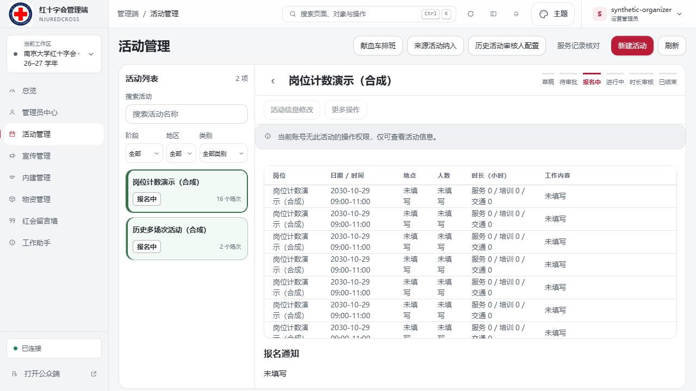

# 多岗位场次数量显示修复

## 问题与范围

管理端活动目录原先使用分组内全部记录的条数显示场次。一项已生成岗位的活动包含 1 条活动主记录与 N 条岗位记录，因此设置 2 个岗位会显示 3，设置 16 个会显示 17。保留在目录中的历史已移除岗位也可能导致数量进一步偏大。

这是前端展示计数错误；后端同时保存活动主记录与岗位子记录用于审批和流程关联，不能为修复显示而删除其中的记录。

## 改动

- `activity-workspace-page.js` 单独计算用于目录展示的 `sessionCount`：有岗位计划时采用当前计划的岗位数量，无岗位计划时统计实际场次并排除主记录。
- 场次数文字与卡片的 `data-sessions` 使用同一数量。
- 保留原始 `sessions` 集合，用于主活动／子岗位链接解析；不改变共享分组模型或其他业务工作区。
- 不改后端接口、存储、审批、报名数据或权限，不写远程业务表。

## 验证

新增 `tests/browser/activity-directory-count.spec.mjs`，在本地内存预览中模拟主记录与岗位子记录。修复前计数断言失败，修复后 Edge 桌面／手机共 6 项全部通过：

- 分别设置 1、2、16 个岗位，卡片计数与配置一致；单岗位不再显示为 2 场。
- 多岗位项目存在历史已移除岗位时，仍只显示当前配置数。
- 无岗位计划的历史双场次活动继续显示 2 个场次。
- 从子岗位链接进入仍能解析到原活动主页面。

```powershell
$env:PLAYWRIGHT_PREVIEW_PORT='3123'
npx playwright test --config=playwright.edge.config.mjs tests/browser/activity-directory-count.spec.mjs --reporter=line
```

`npm run check:links` 通过（1019 个模块），`git diff --check` 通过。完整 `npm run verify` 退出码为 0，项目检查、ESLint、权限／身份／资料检查和 Node 套件全部通过；Node 测试 2411 项通过、0 项失败、0 项跳过。

## 交付状态

用户已要求将本修复与 40% 底色版本一并更新至 PR #26；CI 和合并状态以 GitHub 为准，尚未部署。回滚本修复只需恢复目录的计数代码及对应回归测试，无数据迁移。

## 合成截图


