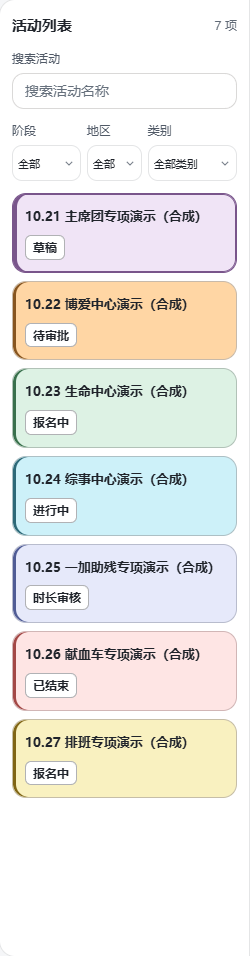
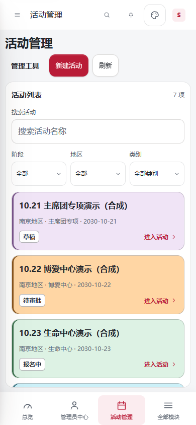

# 活动列表类别配色与进度标签

基于 `origin/main` 的 `314c1eb03b73a8aea13c6faf6896bb2d0e3050f9`，分支为 `codex/activity-list-colors`。之前的 `codex/activity-draft-inline` 分支保留，未混入本次修改。

当前结论：Windows 测试权限阻塞已修复，`npm run verify` 完整通过，Node 套件 2411 项通过、0 项失败、0 项跳过。下文保留修复前的问题记录，具体修复见末节。

## 本轮改动

- 管理端活动卡片的背景和左侧色线表示活动类别，采用当前活动广场实际生效的配色：主席团紫、博爱橙、生命绿、综事青蓝、一加助残淡蓝紫、献血车浅红、排班黄。类别配色与站点主题色分开。
- 活动广场与管理端共用 `tokens.css` 的类别颜色，原活动广场视觉保持不变。未匹配类别保留中性背景。
- 当前选中活动使用更明显的同色边框，键盘聚焦时另有深色轮廓。
- 进度文字使用加粗、深色文字、浅底和独立边框，保留“草稿”“待审批”“报名中”等原有文案。进度不再另设一套彩色含义，避免与类别混淆。
- 保留列表宽度、筛选、场次数、滚动及手机端列表／详情切换。

界面改动仅涉及样式；另修复了本地 Windows 测试夹具，并同步测试指南、变更记录和本说明。未修改业务 JavaScript、接口、权限、活动状态判定、依赖或表结构。未向远程业务表写入数据，未发送邮件。

## 验证

- `npm run check:links`：通过，扫描 1018 个模块。
- `git diff --check`：通过。
- Edge 桌面／手机相关 Playwright：14 项通过，2 项为仅适用桌面的检查在手机项目中正常跳过。检查活动卡片事实与导航、地区／类别组合筛选、草稿恢复、独立滚动、手机列表返回位置和目录失败重试。

  ```powershell
  $env:PLAYWRIGHT_PREVIEW_PORT='3122'
  npx playwright test --config=playwright.edge.config.mjs tests/browser/mobile-activity-workspace.spec.mjs tests/browser/activity-taxonomy.spec.mjs tests/browser/activity-draft-workspace-v2.spec.mjs --grep 'six organization|region, legacy|phone opens|mobile deep links|initial directory|new activity requires|desktop workspace keeps|shared console rail' --reporter=line
  ```

- 额外合成页面检查：7 类活动在管理端与活动广场颜色一致，进度标签加粗且有边框，1440、390、320 像素宽度下无横向溢出，选中项、键盘聚焦和类别筛选正常。已查看桌面和手机截图。
- **修复前** `npm run verify` 未全部通过：项目检查、lint、权限／身份／资料检查通过；Node 测试 2410 项通过、1 项失败。失败位于 `tests/web-assets.test.mjs:194` 的符号链接隔离测试，Windows 创建符号链接时报 `EPERM`。在受限环境外单独重跑 `node --test tests/web-assets.test.mjs`，仍为 18 项通过、同一项权限错误。当时未跳过此检查或修改系统权限，后续通过兼容夹具解决，见末节。
- **修复前复测**默认并发的 `npm run verify` 时，另有 `materials-preview.test.mjs` 文件级失败，未提供更具体的错误；单独重跑该文件 16 项全部通过。随后以 `node --test --test-concurrency=4 tests/*.test.mjs` 重跑完整 Node 套件，仍为 2410 项通过、仅上述符号链接权限测试失败。该次文件级失败的原因未确认，未改动物资模块或测试；修复后的完整检查中未再出现。
- 初次扩大筛选范围时还选中了与本次样式无关的最终时长表测试：Edge 项目名与预览脚本只为 Chromium 预置的活动名称不匹配，桌面／手机各失败 1 项。重新限定本次相关用例后得到上述 14 项通过。未把这两项算作通过，也未修改业务或预览脚本以消除失败。
- 验证在本地完成，尚未部署，线上结果未验证；PR 与 CI 的后续状态以 GitHub 为准。

## 合成截图

桌面目录：



手机目录（390 × 844）：



截图使用合成名称、日期和本地内存数据，不含真实报名信息。

## 恢复

按提交恢复本轮三个样式文件即可恢复旧外观；测试兼容修改位于 `tests/web-assets.test.mjs`，可独立恢复。无数据库、权限或接口迁移。合并与部署按仓库正常流程进行，不以本地验证代替 CI 或线上发布检查。

## Windows 检查阻塞修复

上述 `EPERM` 属于修复前的验证记录，后续已处理：Windows 分支使用普通账号可创建的目录联接，实际指向 `styles` 之外的合成 CSS；其他系统保留原文件符号链接。两条路径均保留真实的越界拒绝断言、循环导入拒绝和递归深度限制检查，未跳过测试，未修改生产打包器，也未变更系统权限。

修复后在当前普通 Windows 环境执行：

- `node --test tests/web-assets.test.mjs`：19 项通过、0 项失败、0 项跳过。
- `npm run verify`：退出码 0，项目检查、ESLint、权限／身份／资料检查及完整 Node 套件全部通过；Node 测试 2411 项通过、0 项失败、0 项跳过。
- `npm run check:links`、`git diff --check`：通过。

未修改全量命令、降低并发要求或设置跳过开关。其他系统的文件符号链接分支代码保持原样，本机未执行 Linux 环境验证，仍由跨平台 CI 确认。
