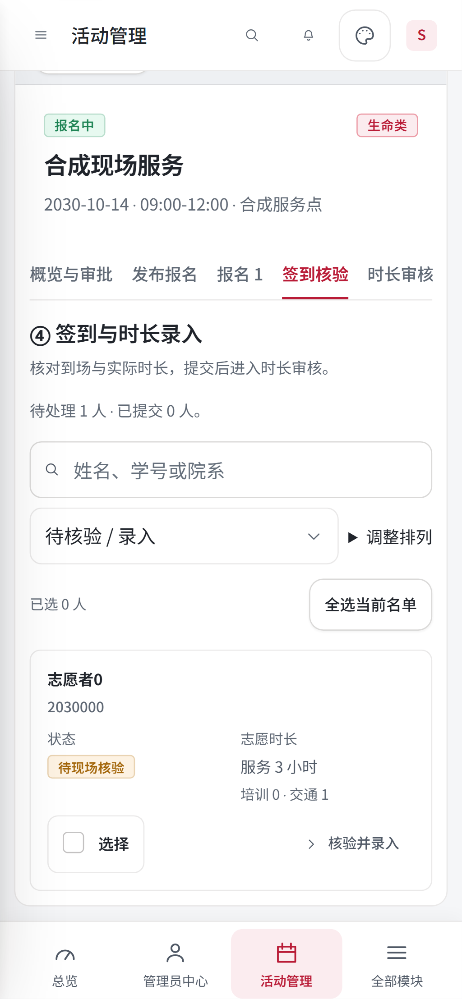
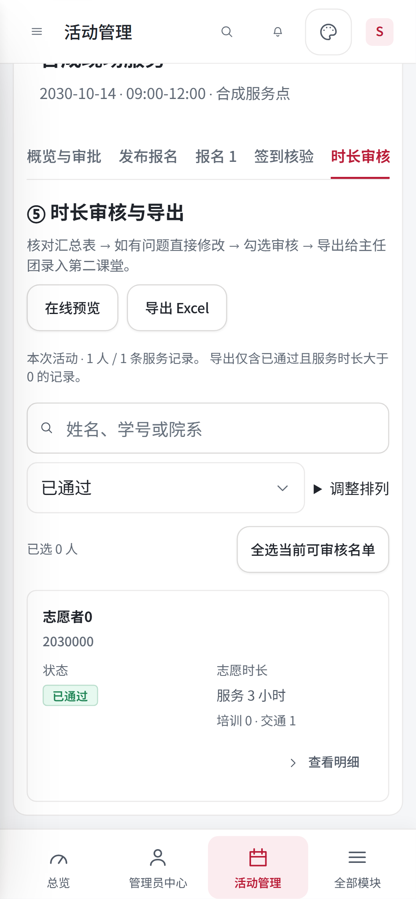
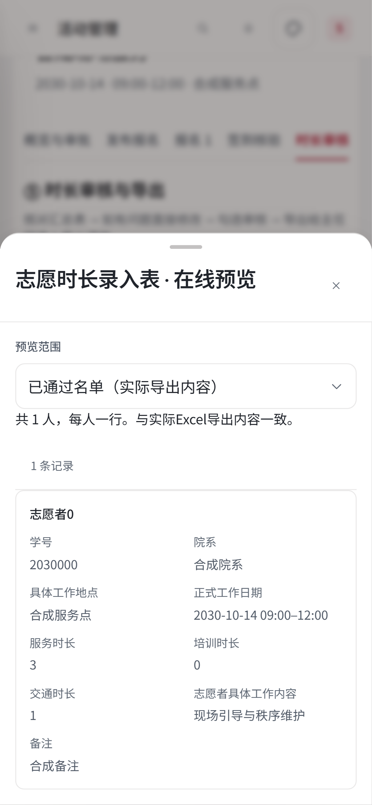

# 签到核验与时长导出移动端适配

基线：main `61a3332`；开发账号：xinyue-L01。沿用活动中心现有原生 JavaScript、共享表单与主题颜色，适配范围为 800px 及以下，与通用记录列表断点一致。

## 页面变化

- 签到、时长审核和导出预览直接使用后台已有 `recordTable`，搜索使用共享 `searchField`；复选框、状态徽标、按钮和详情面板沿用共享组件。
- 列表只读显示姓名、学号、状态和三项时长，点击记录或操作进入现有详情编辑；每页 25 人，翻页保留选择，支持键盘打开。
- 移除单独实现的手机表格网格、三项输入框、嵌套卡片边框和筛选区底色。移动端列表采用通用双列摘要和小型操作按钮。
- 在线预览用同一组件展示全部字段，核验与明细表单单列排列。桌面保留原有可编辑表格；业务请求、权限、审核条件、月度汇总及 Excel 文件结构沿用现有实现。
- 修正通用手机卡片继承桌面单元格宽度、高度与内边距的问题，使用现有 `--r-md` 圆角变量，避免窄操作列溢出。

## 验证

Windows、Node 24.13.1；全部使用内存合成服务器及拦截的合成响应。

- `npm ci --ignore-scripts`：同步最新 main 的锁定依赖，审计 0 漏洞。
- `npm run verify`：通过，Node 测试 1900/1900；含项目检查、ESLint、权限、身份、志愿资料回归。
- `npm run check:links`：通过。
- `PLAYWRIGHT_PREVIEW_PORT=3122 npx playwright test tests/browser/field-workspace.spec.mjs tests/browser/outreach-review-draft.spec.mjs tests/browser/console-scroll-state.spec.mjs`：40 通过，4 按桌面/手机适用范围跳过。端口环境变量在 PowerShell 中用 `$env:PLAYWRIGHT_PREVIEW_PORT` 设置。
- 签到检查 360/390/600/720px 卡片边界、卡片高度、摘要字段、分页选择与核验入口；原回归覆盖 0/1/20/200 人、失败重试、未保存输入、照片失败、五主题及桌面宽度。
- 时长检查摘要列表隐藏详细字段，进入明细后院系、日期、工作内容及备注可见，实际导出范围预览保留完整字段与下载触发。下载使用合成响应；文件结构由现有 XLSX/时长导出单元测试验证。

## 合成数据截图

## 发布

协作者主题分支通过 PR 合并，合并后的生产部署由 main 的 Quality gate 触发。开发基线的 Actions 部署已成功，回执提交为 `61a3332be549e1f5a372ca4fbd5d0b52a97114e5`，核验运行文件 417 个。本次适配的生产验收在 PR 合并部署后执行。

恢复时回退本次前端样式、预览单元格标签与文档即可；数据结构保持现有版本。
